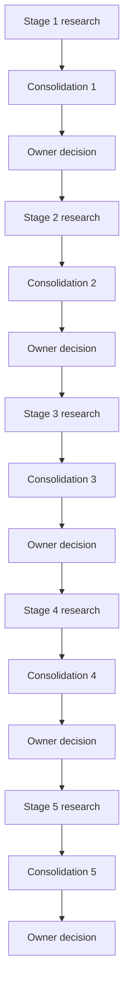

# IRIS-X Core Research Formulation Program

- **Status:** amended protocol accepted / research not started
- **Program ID:** `irisx-core-formulation-v1`
- **Supersedes:** `irisx-core-formulation-v0`; no stage was executed under v0
- **Phase 1–6 evidence baseline:**
  `8f8f264b841369918f6bab21c3a749a27f51dc57`
- **Program-definition baseline:** the owner-accepted commit containing these
  files; it must be pinned explicitly before Stage 1
- **Research execution:** not authorized by these files

This directory defines a five-stage, GPT-5.6 Sol-led research program for
discovering and defending the core IRIS-X research formulation. It is a
research protocol, not Phase 7, an experiment, authorization for a research
task or model run, an architecture decision, or a final thesis.

The program uses five independent Codex research tasks. Each task receives a
clean conversational context and the cumulative authoritative state. After a
stage report is frozen, a separate, bounded consolidation task proposes the
state update. Only an owner-accepted consolidation may advance the program.

## Model policy

| Task | Exact model | Reasoning setting |
| --- | --- | --- |
| Stage 1 | `gpt-5.6-sol` | `max` |
| Stages 2–5 | `gpt-5.6-sol` | `ultra` |
| Post-stage consolidation | `gpt-5.6-sol` | `max` |

`max` is a public GPT-5.6 Sol API reasoning effort. `ultra` is the Codex
app-native reasoning setting used by this program and must not be represented
as an API `reasoning.effort` value. The exact configured model and setting must
be frozen in the launch record. No alias substitution, model substitution, or
silent downgrade from `ultra` to `max` is permitted.

## Files

- [`protocol.md`](protocol.md) — common method, authority rules, memory model,
  stage boundaries, and acceptance gates.
- [`state/current-state.json`](state/current-state.json) — initial cumulative
  authoritative state. It contains no completed stage result.
- [`prompts/state-consolidation.md`](prompts/state-consolidation.md) — common
  post-stage consolidation prompt.
- [`prompts/stage-1-research-constitution.md`](prompts/stage-1-research-constitution.md)
  — scope, method, and evaluation-criterion formation.
- [`prompts/stage-2-evidence-reconstruction.md`](prompts/stage-2-evidence-reconstruction.md)
  — Phase 1–6 and corpus evidence reconstruction.
- [`prompts/stage-3-problem-discovery.md`](prompts/stage-3-problem-discovery.md)
  — cross-source synthesis, external challenge, and candidate formulations.
- [`prompts/stage-4-formulation-adjudication.md`](prompts/stage-4-formulation-adjudication.md)
  — adversarial comparison and selection or a justified no-selection result.
- [`prompts/stage-5-theory-and-program.md`](prompts/stage-5-theory-and-program.md)
  — final theory, thesis, research questions, hypotheses, and experimental
  program design.

## Execution topology

Each research (`R`) and consolidation (`C`) node itself expands into the
owner-separated launch and later collection turns required by root `AGENTS.md`.
The launch turn cannot inspect output; collection requires a later explicit
owner request.

Creating or reading these files does not authorize any arrow in this sequence.
Each research task and each state promotion requires separate owner direction.
